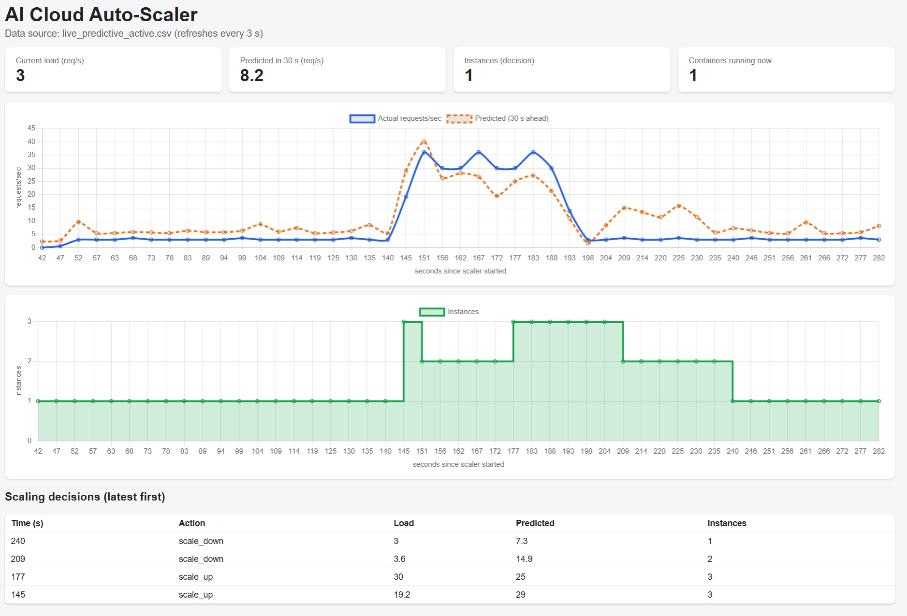
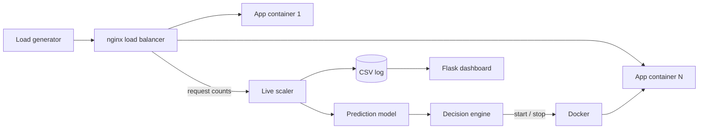

# AI-Based Cloud Resource Monitoring and Auto-Scaling

Course project (Version Control / Cloud Computing).
Authors: **YOUR NAME** and **TEAMMATE NAME**

A small system that watches how busy a web service is, predicts the load a
short time ahead with machine learning, and starts or stops Docker containers
to match. It is compared against a simple threshold rule and against no
scaling at all.



## What it does

1. **Monitor:** a collector records CPU, memory and requests/sec.
2. **Predict:** a random forest estimates the request rate 30 seconds ahead.
3. **Decide:** a decision engine turns the prediction into scale up, scale
   down or hold, with min/max limits and a cooldown to prevent flapping.
4. **Act and show:** real Docker containers are started and stopped behind an
   nginx load balancer, and a live dashboard shows everything.

## Architecture



| Folder | Purpose |
|---|---|
| `sampleapp/` | Flask app (uses CPU per request) and its Dockerfile |
| `collector/` | Records CPU, memory and requests/sec into SQLite |
| `loadgen/` | Traffic patterns: steady, ramp, spike, wave |
| `model/` | Training script and the saved model |
| `scaler/` | Decision engine, predictor, replay simulator, live scaler, nginx config |
| `dashboard/` | Live web dashboard (Flask + Chart.js) |
| `evaluation/` | Runs no scaling, threshold and predictive scaling on the same traffic |
| `docs/` | Graphs, results and the decisions log |

## Requirements

Python 3.10+, Git, and Docker Desktop (for the live scaling part).

```powershell
python -m venv venv
venv\Scripts\activate
pip install -r requirements.txt
```

## How to run it

**1. Replay on recorded data (no Docker needed)**

```powershell
python scaler/simulate.py spike
```

**2. Live scaling with Docker**

```powershell
docker build -t autoscaler-app sampleapp
docker network create scalenet
docker run -d --name lb --network scalenet -p 8080:80 -v "${PWD}/scaler/nginx.conf:/etc/nginx/nginx.conf:ro" nginx:alpine
docker run -d --name web1 --network scalenet --network-alias web --cpus 0.5 autoscaler-app

python dashboard/server.py                       # terminal 1: http://localhost:5050
python scaler/live.py                            # terminal 2: advice only (safe default)
python scaler/live.py --active                   # terminal 2: really scales containers
python loadgen/loadgen.py spike 240 http://localhost:8080/    # terminal 3: traffic
```

**3. Re-run the evaluation (about 15 minutes)**

```powershell
python evaluation/run_eval.py spike 240
```

**Re-collecting training data** (the `.db` files are not committed):
run `python sampleapp/app.py`, then for each pattern start
`python collector/collector.py data/<pattern>.db` and
`python loadgen/loadgen.py <pattern> 600`, then `python model/train.py`.

## Results

Same spike traffic (3 -> 30 -> 3 requests/sec, 240 s), one container at start,
0.5 CPU per container, 1 to 5 containers allowed.

| Strategy | Median latency | p95 latency | Slow or failed | Avg containers |
|---|---|---|---|---|
| No scaling | 5.83 s | 15.86 s | 73.6% | 1.00 |
| Threshold rule | 0.57 s | 5.94 s | 39.7% | 1.19 |
| Predictive | 0.43 s | 5.12 s | 28.0% | 1.52 |

"Slow" means slower than 1 second. See `docs/evaluation_spike.png` for the graph.

- Both scalers clearly beat no scaling.
- The predictive scaler had the lowest latency but used about 28% more
  container-time than the threshold rule: a cost versus speed trade-off.

### Prediction model (30 s ahead), honest summary

Tested leave-one-pattern-out (train on three patterns, test on the fourth).
A simple "repeat the last value" baseline had the lowest error on steady, ramp
and spike traffic. The models were only marginally better on wave traffic.
The model cannot foresee a sudden spike from past readings. The predictive
scaler's advantage comes from sizing its response in one step, while the
threshold rule adds one container per cooldown period.

## Limitations

- Small dataset (about 60-78 rows per pattern, 5 s apart).
- One evaluation run per strategy, so small differences may be noise.
- Local Docker only. Real cloud (AWS CloudWatch/EC2) is future work.
- Capacity per container (20 requests/sec) is an estimate.
- Latency includes client-side queueing when the server is overloaded.
- Prediction horizon is 30 s because the recorded runs are short.

## Future work

Longer-horizon forecasting on longer data, cost-aware scaling decisions,
Kubernetes or AWS integration, more metrics, and repeated evaluation runs.

## Git workflow

One feature branch per task, merged through pull requests, small commits with
clear messages. The release is tagged `v1.0-demo`. Design choices are recorded
in `docs/decisions-log.md`.